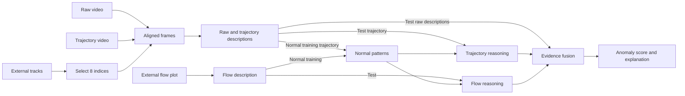

# MUSTARD

MUSTARD detects industrial video anomalies using flow-guided keyframes, normal
motion patterns, and language-model reasoning. The Phys-AD implementation includes the main method, modality recipes, direct-Qwen
selection comparisons, baseline import, and explanation evaluation. The supplied
manuscript is *Spatiotemporal Dynamics-Aware Industrial Anomaly Detection and Reasoning*.
Historical main-table run scripts are unavailable; reconstruction decisions and
validation limits are documented rather than claiming reproduced paper scores.

## Scope

This release targets Phys-AD. IPAD experiments are deferred and will be added later.

External preprocessing supplies raw videos, trajectory videos with arrows already
rendered, optical-flow tracks, and flow-magnitude plot images. This repository
selects keyframes, extracts aligned raw/trajectory frames, generates descriptions,
extracts normal patterns, performs reasoning/fusion, and evaluates predictions.
Tracking, arrow rendering, and plot generation are maintained separately.

No datasets, model weights, generated patterns, predictions, or experiment results
are included. Keep all working artifacts outside this repository.

## Main flow



## Install

Python 3.10 or newer:

```bash
python -m pip install -e .
```

For inference, run an external Ollama server with `qwen2.5vl:7b` and `gemma3:12b`
available. Model tags are resolved to digests before use; patterns record the
resolved identities and inference requires matching models.

Start with the [quick start](docs/QUICKSTART.md). Full commands and reconstructed
comparison recipes are listed in [EXPERIMENTS.md](docs/EXPERIMENTS.md).

## Prepare inputs

The default indexer expects four parallel directory trees:

```text
raw/        {object}/train/{video}.mp4
            {object}/test/{anomaly}/{video}.mp4
trajectory/ same relative mp4 paths
tracks/     same relative paths, using {video}.npy or {video}_tracks.npy
plots/      same relative paths, using {video}_tracks.png
```

Both videos must preserve the same frame indexing and decoded length as the
tracks array, shaped `(frames, points, 2)`. Normal test directory names default
to `norm`, `normal`, `good`, and `anomaly_free`; override them when indexing another dataset.
For other layouts, supply an explicit manifest as described in
[data contracts](docs/DATA.md).

```bash
mustard index \
  --raw-root /data/raw --trajectory-root /data/trajectory \
  --tracks-root /data/tracks --plots-root /data/plots \
  --out /work/mustard/manifest.json
```

## Extract normal patterns

```bash
mustard train \
  --manifest /work/mustard/manifest.json \
  --config configs/paper.json \
  --host http://127.0.0.1:11434 \
  --work /work/mustard/cache \
  --out /work/mustard/patterns.json
```

For each category, select 30 normal training videos with a recorded category-specific seed and
save their IDs and input hashes. Generate trajectory descriptions at each of
eight selected frame positions, then summarize the references position by
position. Concatenate these eight patterns in temporal order. There is no extra
LLM summarization call after concatenation. Flow descriptions are summarized into
a separate 13-field normal pattern. No model weights are updated.

The recovered keyframe configuration uses mean motion and endpoint/peak/valley/
shoulder priority. Its historical `smooth_win=8` parameter is rounded to an odd
nine-point smoothing window, matching the original implementation.

## Inference and AUROC

```bash
mustard infer \
  --manifest /work/mustard/manifest.json \
  --patterns /work/mustard/patterns.json \
  --config configs/paper.json \
  --host http://127.0.0.1:11434 \
  --work /work/mustard/cache \
  --out /work/mustard/predictions.json

mustard evaluate \
  --manifest /work/mustard/manifest.json \
  --predictions /work/mustard/predictions.json \
  --out /work/mustard/metrics.json
```

Raw descriptions plus dynamic and flow reasoning feed the final fusion. Individual
modality score lines are removed before fusion. Evaluation requires exactly the
test samples declared by the manifest and reports per-object, macro, and pooled
AUROC. Single-class categories have an undefined per-object AUROC and are excluded
from the macro average with the eligible count reported explicitly.

Successful model calls are cached by image/text content, prompts, options, and
model digest. Failed or unparsable calls are not marked complete. Calls resume
through the same work directory. Configuration or model changes produce new keys.

## Explanation evaluation

PAEval and pairwise comparison default to `gpt-4o-2024-08-06`, following the paper's
GPT-4o judge choice. Credentials are read from `OPENAI_API_KEY`. These commands make
external API requests when explicitly run.

```bash
mustard paeval \
  --predictions /work/mustard/predictions.json \
  --labels /data/correct_ground_truth.json \
  --work /work/mustard/judge-cache \
  --out /work/mustard/paeval.json

mustard pairwise \
  --predictions /work/mustard/predictions.json \
  --baseline /work/baseline/predictions.json \
  --labels /data/correct_ground_truth.json \
  --work /work/mustard/judge-cache \
  --out /work/mustard/pairwise.json
```

Baseline predictions use the same prediction schema and must match video IDs.
See [baseline integration](docs/BASELINES.md) for external methods and normalization.
Full-model fusion is evaluated using `Final Explanation:`, following the exporter
version associated with the paper's PAEval input. Use `--field reasoning` only
for an explicit technical-reasoning comparison. Single-source and external baseline
records preserve an explicitly supplied explanation and identify its source; they
do not silently substitute for a missing full-model field.
Pairwise answer order is randomized with a recorded seed and mapped back to
system identity before computing win rates. Judge calls are cached and resumable.
See [reproduction notes](docs/REPRODUCIBILITY.md) for scope and remaining checks.

## Single-video keyframe extraction

```bash
mustard keyframes \
  --raw-video /data/raw/ball/test/norm/0030.mp4 \
  --trajectory-video /data/trajectory/ball/test/norm/0030.mp4 \
  --tracks /data/tracks/ball/test/norm/0030_tracks.npy \
  --config configs/keyframes.json \
  --out /work/mustard/frames/ball/test/norm/0030
```

Both modalities share a single selection manifest. Existing directories are not
overwritten; mismatched inputs do not leave a completed sample.

## Development

```bash
PYTHONPATH=src python -m unittest discover -s tests -v
```

Tests use synthetic inputs and mock model/judge responses, with no GPU or API
calls. See [validation details](docs/VALIDATION.md) for the installed-wheel check. Source attribution is tracked in [SOURCES.md](docs/SOURCES.md).
[Version policy](docs/VERSION_POLICY.md) records the source decisions and intentional fixes.
